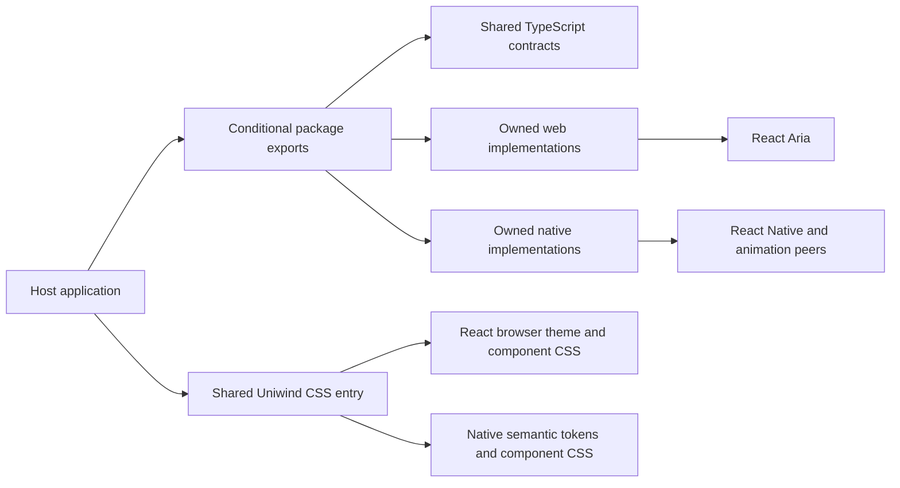

# Architecture

The package owns the HeroUI implementations that back its public components. Conditional exports choose `.web.tsx` or `.native.tsx` facades over local primitives; runtime imports never resolve to the HeroUI component packages.

## Source and output

- `src/components/` owns public contracts in `*.types.ts`, platform facades, compound parts, and provenance. Native Button and Chip retain their own variant selection in `*.styles.ts`.
- `src/primitives/web/` and `src/primitives/native/` own copied behavioral implementations and their transitive support modules. Relative imports resolve within the package; broad helper imports are narrowed where safe to avoid pulling unused optional integrations into the graph.
- `src/styles/web/` retains the pinned React slot classes and utility variants. `styles/react/` owns the complete pinned React CSS tree, including state styles, transitions, animation keyframes, and default browser theme. `styles/shared/` owns Native semantic tokens and component CSS. The package uses HeroUI's default semantic palette; apps can override tokens in their global stylesheet.
- `styles/index.css` is the shared Uniwind entry for every platform. It gates Native component styles and hairlines with the `native` media condition and React browser rules with Uniwind's web supports condition. Tailwind definitions remain at the top level.
- `styles/native.css` includes Tailwind, Uniwind, shared styles, and native hairline utilities. `styles/web.css` includes Tailwind, the React theme and styles, and adapter extensions in `web-only.css`. Both web-capable entries include `tw-animate-css`, shipped as a package dependency.
- Both TypeScript builds include local declarations for the opposite platform's extension props. Refs stay platform-specific. Generated output under `build/` is never edited by hand.
- `upstream/` remains pinned and read-only. `baselines/` remains an unchanged Stage 1 reference with independent builds. Neither is used as a runtime package dependency.

## Contracts and behavior

Shared direct props live in a single module for each public component. Platform options omit shared props and refs. Field roots and parts retain their locally copied React Aria and Native contexts; native animation, press feedback, text settings, portals, and provider behavior remain in the owned implementation graph.

The package adds no native module, autolinking, Swift, or Kotlin. Static checks establish source resolution and typing; they do not establish rendering, accessibility, native compilation, or functional parity. See the [migration record](../changes/archive/stage-2-public-surface.md) for scope, deviations, and remaining verification.

## Related documentation

- [Architecture decisions](decisions/README.md)
- [Components](../api/components.md)
- [Source ownership and upgrades](../upstream/upgrade-guide.md)
