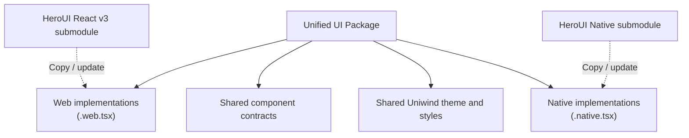
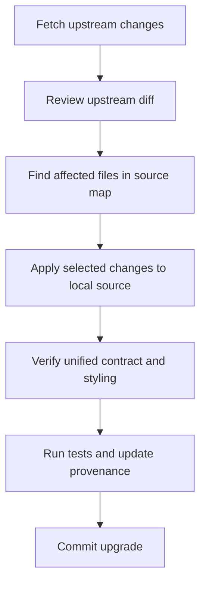

# Plan: Build a unified HeroUI package for React and React Native

I recommend creating a source-owned, cross-platform UI library based on HeroUI React v3 and HeroUI Native, with two separate refactoring stages and full upstream traceability.

The goal is to maintain one public component API, one design system, and one styling approach using Uniwind, while retaining the original implementations as editable source code.

## 1. Architecture

Recommended

&#x20;Source-owned components with platform-specific implementations.



### Core requirements

| Area             | Decision                                               |
| ---------------- | ------------------------------------------------------ |
| Upstream         | Two pinned Git submodules                              |
| Source ownership | Copy actual component implementations                  |
| Public imports   | One package, e.g. `@your-org/ui`                       |
| API              | Unified component names, props, events and composition |
| Styling          | Uniwind + Tailwind CSS v4                              |
| CSS              | One authoritative styling system                       |
| Implementation   | Platform-specific only where necessary                 |
| Re-exports       | No forwarding or re-exporting upstream packages        |
| Updates          | Controlled source synchronization                      |
| Traceability     | Per-component provenance and migration records         |
| Migration        | Two distinct stages and Git checkpoints                |

HeroUI React v3 uses React Aria and CSS-based styling, whereas HeroUI Native uses React Native primitives and Uniwind. Both support Tailwind CSS v4 and semantic design tokens, making them suitable starting points.&#x20;

[image](https://www.google.com/s2/favicons?domain=https://heroui.com&sz=32)

HeroUI

+2

## 2. Suggested repository structure

```
unified-ui/
├── upstream/
│   ├── heroui-react/            # Git submodule (v3)
│   └── heroui-native/           # Git submodule
│
├── src/
│   ├── components/
│   │   ├── button/
│   │   │   ├── button.web.tsx
│   │   │   ├── button.native.tsx
│   │   │   ├── button.types.ts
│   │   │   ├── button.styles.ts
│   │   │   ├── index.ts
│   │   │   └── UPSTREAM.md
│   │   ├── input/
│   │   ├── card/
│   │   ├── dialog/
│   │   └── ...
│   │
│   ├── primitives/
│   │   ├── web/
│   │   └── native/
│   │
│   ├── hooks/
│   ├── utils/
│   ├── theme/
│   │   ├── tokens.css
│   │   ├── themes.css
│   │   └── index.css
│   ├── styles/
│   └── index.ts
│
├── docs/
│   ├── README.md
│   ├── architecture/
│   ├── components/
│   ├── upstream/
│   │   ├── react.md
│   │   ├── native.md
│   │   ├── source-map.md
│   │   └── upgrade-guide.md
│   └── changes/
│       ├── active/
│       └── archive/
│
├── scripts/
│   ├── ...
│
├── package.json
├── tsconfig.json
├── CHANGELOG.md
└── README.md
```

This is the intended Stage 2 layout. Stage 1 should preserve upstream source organization wherever possible.

A key distinction: `index.ts` files may export your locally owned components. They should never simply import and re-export HeroUI upstream components.

## 3. Stage 1 — Import and preserve upstream source

Source baseline

Objective: Establish a reproducible baseline containing copied upstream implementations before applying any unification changes.

### Requirements

1. Add both official repositories as Git submodules.
2. Pin each submodule to a specific commit.
3. Identify the current source directories, dependencies, styling files, and component entry points.
4. Copy the necessary component source, internal utilities, hooks, contexts, styles, and types.
5. Preserve the original component names, signatures, logic, and structure.
6. Record every copied file's upstream origin.
7. Retain required license notices and attribution.
8. Configure the copied sources to build in the new repository.
9. Avoid refactoring names, contracts, or styling.
10. Commit this stage independently.

### Submodule initialization

```
git submodule add \
  -b v3 \
  https://github.com/heroui-inc/heroui.git \
  upstream/heroui-react

git submodule add \
  https://github.com/heroui-inc/heroui-native.git \
  upstream/heroui-native

git submodule update --init --recursive
```

Pin and record the resolved commit SHA for each repository. The branch references are useful for discovering updates; the committed submodule pointers define the reproducible baseline.

The relevant React v3 source is under `packages/react/src`, with styling in `packages/styles`. The Native source and its supporting files should be identified from the selected submodule revision.&#x20;

[image](https://www.google.com/s2/favicons?domain=https://github.com&sz=32)

GitHub

+1

### Important: preserve dependencies

Do not copy only the visible `.tsx` components.

Include or explicitly account for:

- Shared hooks and internal contexts.
- Component utilities and variant definitions.
- Animation and overlay behavior.
- React Aria dependencies for web.
- Native gesture, portal, and animation dependencies.
- Uniwind configuration and Tailwind styling.
- Types and accessibility behavior.
- Relevant tests.

Keep external runtime dependencies as dependencies where appropriate. Source ownership does not require vendoring third-party frameworks.

### Source provenance

Each component should have a record such as:

`src/components/button/UPSTREAM.md`

```
# Button — Upstream Provenance

## Sources

React:
- Repository: heroui-inc/heroui
- Ref: <commit-sha>
- Original path: packages/react/src/components/button/

Native:
- Repository: heroui-inc/heroui-native
- Ref: <commit-sha>
- Original path: <verified-source-path>

## Import History

- Original files copied
- Internal dependencies included
- No behavior changes

## Local Changes

None (Stage 1 baseline).

## Upgrade Notes

No local changes.
```

A central source-map should index all components, including upstream-only components and features that have not yet been copied.

### Stage 1 completion criteria

- All selected components and required support files are accounted for.
- The copied code can be built or any unresolved blockers are documented.
- No intentional UI, behavior, API, or styling changes have been introduced.
- Tests or baseline smoke checks are recorded.
- All files have traceable upstream origins.
- Submodule commits and licenses are recorded.

Suggested commit:

```
chore: import HeroUI React and Native source baselines
```

This commit becomes the reference point for every subsequent modification.

## 4. Stage 2 — Unify components, contracts, and styling

Controlled refactoring

Objective: Transform both sets of implementations into one internally consistent UI library.

### 4.1 Unified component contract

Define a shared public API for each component.

For example, the official Native Button uses `onPress` and compound elements such as `Button.Label`, while web components use web event conventions.&#x20;

[image](https://www.google.com/s2/favicons?domain=https://heroui.com&sz=32)

HeroUI

+1

I recommend standardizing interactive event names around React Native semantics, then adapting them internally on web.

| Contract | Unified API | Web implementation | Native implementation |
| --- | --- | --- | --- |
| Action | `onPress` | React Aria press behavior | Native press behavior |
| Disabled | `isDisabled` | Map to underlying disabled state | Map to native disabled state |
| Loading | `isLoading` | Web loading state | Native loading state |
| Size | `sm`, `md`, `lg` | Shared size tokens | Shared size tokens |
| Variant | `primary`, `secondary`, `tertiary`, `ghost`, `danger` | Unified visual meaning | Unified visual meaning |
| Styling | `className` | Tailwind CSS v4 | Uniwind |
| Composition | `Button.Label` | Web implementation | Native implementation |
| Accessibility | Shared intent | ARIA semantics | RN accessibility props |

These are proposed library contracts, not claims that both upstream libraries already implement every item identically.

For platform-specific functionality, expose it only when justified, through documented extension props or discriminated types.

Example desired usage:

```
import { Button } from "@your-org/ui";

<Button
  variant="primary"
  size="md"
  isLoading={false}
  onPress={handleSubmit}
>
  <Button.Label>Submit</Button.Label>
</Button>
```

The same usage should work on React web and React Native.

### 4.2 Unified styling via Uniwind

Use one authoritative theme, token vocabulary, and component styling definition.

HeroUI React v3 currently separates behavior into `@heroui/react` and CSS styling into `@heroui/styles`. HeroUI Native uses Uniwind and Tailwind CSS v4.&#x20;

[image](https://www.google.com/s2/favicons?domain=https://heroui.com&sz=32)

HeroUI

+1

For your package:

- Consolidate semantic tokens into a shared theme.
- Use Uniwind-compatible Tailwind utilities for component styling.
- Centralize component variants, sizes, colors, and state styles.
- Avoid separate hand-maintained web/native token definitions.
- Avoid introducing another CSS-in-JS framework.
- Remove redundant upstream style implementations only after confirming equivalent behavior.
- Preserve browser-specific CSS or native-specific styling only where required by platform capabilities.
- Document any necessary platform differences.

Important limitation: A shared Uniwind styling system does not guarantee identical rendering engines. Browser pseudo-classes, CSS selectors, focus indicators, and some layout or animation behavior are not directly interchangeable with React Native.

The realistic target is one styling source of truth, with minimal platform-specific implementation details—not a requirement that every generated style rule be identical.

### 4.3 Component refactoring order

| Priority | Component group                          | Focus                            |
| -------- | ---------------------------------------- | -------------------------------- |
| P0       | Tokens, typography, primitives           | Shared foundations               |
| P1       | Button, Input, Card, Chip                | Contract and styling conventions |
| P2       | Checkbox, Switch, Radio, Slider          | Interaction states               |
| P3       | Select, Dialog, Popover, Menu            | Overlays and accessibility       |
| P4       | Tabs, Accordion, Form                    | Composition and context          |
| P5       | Complex or platform-exclusive components | Compatibility and extensions     |

Refactor one component at a time, including its contracts, implementations, styles, tests, and documentation.

Do not force web-only or native-only features into an artificial common contract.

## 5. Upgrade and traceback workflow

Keep upstream source read-only inside the submodules. Make all local modifications exclusively within the owned package.



An upgrade should never blindly replace locally refactored code.

Maintain a machine-readable component source map alongside the Markdown documentation. For each component, capture:

- Original upstream paths and baseline commits.
- Last upstream revision reviewed.
- Last upstream revision incorporated.
- Local implementation paths.
- Renamed or transformed public APIs.
- Local behavior and styling deviations.
- Known unapplied upstream changes.

Compare upstream commit ranges since the last incorporated revision, not merely since the original import. This prevents losing fixes that were already cherry-picked.

For upgrade commits, use a message such as:

```
chore(upstream): sync HeroUI button fixes
```

Include the upstream commits and affected components in the commit body or linked upgrade documentation.

## 6. Quality and compatibility rules

Every component should satisfy these checks before being considered unified:

- Both platform entry points resolve correctly.
- Public API and TypeScript declarations are consistent.
- Public imports never resolve to upstream component re-exports.
- Visual variants and tokens are consistent.
- Disabled, loading, focus, press, and accessibility states are tested as applicable.
- Web keyboard and screen-reader behavior remains intact.
- Native touch, gestures, accessibility, and animations remain functional.
- Platform-only features are documented.
- Source provenance points to exact upstream files and revisions.
- Source mapping remains valid after moving or renaming files.

Use web component tests and browser interaction checks alongside native tests on both iOS and Android. Do not treat passing TypeScript compilation as evidence of functional parity.

## 7. Agent implementation instruction

You can give the following to Codex as the working instruction:

# Unified HeroUI React and Native Library

Create a source-owned, cross-platform UI package based on HeroUI React v3 and HeroUI Native.

## Non-negotiable requirements

- Keep both official upstream repositories as pinned Git submodules.
- Copy and maintain actual component implementations locally.
- Do not build a package that simply imports and re-exports upstream components.
- Use Uniwind and Tailwind CSS v4 as the unified styling foundation.
- Maintain one authoritative design-token system and component styling contract.
- Preserve platform-specific implementations where browser and React Native capabilities differ.
- Expose a consistent public component API across web and native.
- Preserve accessibility, interaction semantics, and upstream behavior unless an intentional, documented change is required.
- Maintain complete upstream source provenance and a repeatable upgrade workflow.
- Follow the existing repository's tooling and conventions where appropriate.
- Do not modify upstream submodule contents.

## Stage 1 — Source import and baseline

1. Inspect the official HeroUI React v3 and HeroUI Native repositories.
2. Record their versions, exact commits, licenses, source structure, dependencies, and styling architecture.
3. Add both repositories as Git submodules.
4. Inventory available components and their required internal dependencies.
5. Copy the selected component implementations, styles, utilities, hooks, contexts, types, and relevant tests into the new package.
6. Preserve upstream naming, contracts, behavior, and source organization during this stage.
7. Establish a reproducible build baseline without making functional or design changes.
8. Add per-component provenance records and a central source map.
9. Document any unsupported or blocked builds without silently altering component behavior.
10. Commit Stage 1 independently.

Commit message:\
`chore: import HeroUI React and Native source baselines`

Do not begin Stage 2 before the Stage 1 commit is complete.

## Stage 2 — Unified architecture and API

1. Define canonical component names, types, props, variants, events, and composition patterns.
2. Establish shared TypeScript contracts with platform-specific extensions only where justified.
3. Consolidate themes, semantic tokens, sizes, and variants under Uniwind and Tailwind CSS v4.
4. Maintain a single authoritative styling system without duplicating hand-maintained web/native style definitions.
5. Refactor locally copied implementations into platform-specific source files where needed.
6. Replace divergent upstream APIs with the agreed unified contracts.
7. Preserve web accessibility and native interaction behavior.
8. Remove redundant copied styles and utilities only after verifying their replacements.
9. Add component tests, visual checks, type checks, and representative integration examples.
10. Document component API mappings, platform differences, and upgrade implications.
11. Keep all changes traceable to the original upstream sources.
12. Commit refactoring incrementally by component or cohesive component group.

## Documentation

Maintain:

- `docs/README.md` as the documentation entry point.
- `docs/architecture/` for architecture and design decisions.
- `docs/components/` for public API documentation.
- `docs/upstream/` for upstream versions, source maps, synchronization, and upgrade instructions.
- `docs/changes/` for substantial migration plans and completed work.
- `CHANGELOG.md` for public behavior changes.

Every copied component must retain a record of its upstream repository, original path, baseline commit, incorporated changes, local deviations, and last synchronized revision.

## Upgrade policy

- Never overwrite locally modified components blindly.
- Inspect and map upstream changes before incorporating them.
- Apply relevant upstream fixes to locally owned source.
- Preserve the canonical public API and shared styling rules.
- Run regression tests on both platforms.
- Update provenance records and the changelog for relevant changes.
- Keep upstream synchronization separate from unrelated feature work.

## Implementation boundaries

Implement the work in exactly two major stages: source baseline, then unification.

Within Stage 2, use small reviewable commits.

Do not prematurely rewrite all components or remove functionality solely to achieve uniformity.

The final package must expose owned implementations through platform-aware entry points and must not require upstream HeroUI component packages as runtime component dependencies.

One additional recommendation: before Stage 2, explicitly approve the canonical API conventions (`onPress`, `isDisabled`, variants, compound components). That decision will have a much larger effect on long-term maintenance than the initial directory structure.

Official references: [HeroUI React source](https://github.com/heroui-inc/heroui?utm_source=chatgpt.com) · [HeroUI Native source](https://github.com/heroui-inc/heroui-native?utm_source=chatgpt.com) · [Uniwind theming](https://heroui.com/en/docs/native/getting-started/theming?utm_source=chatgpt.com)
